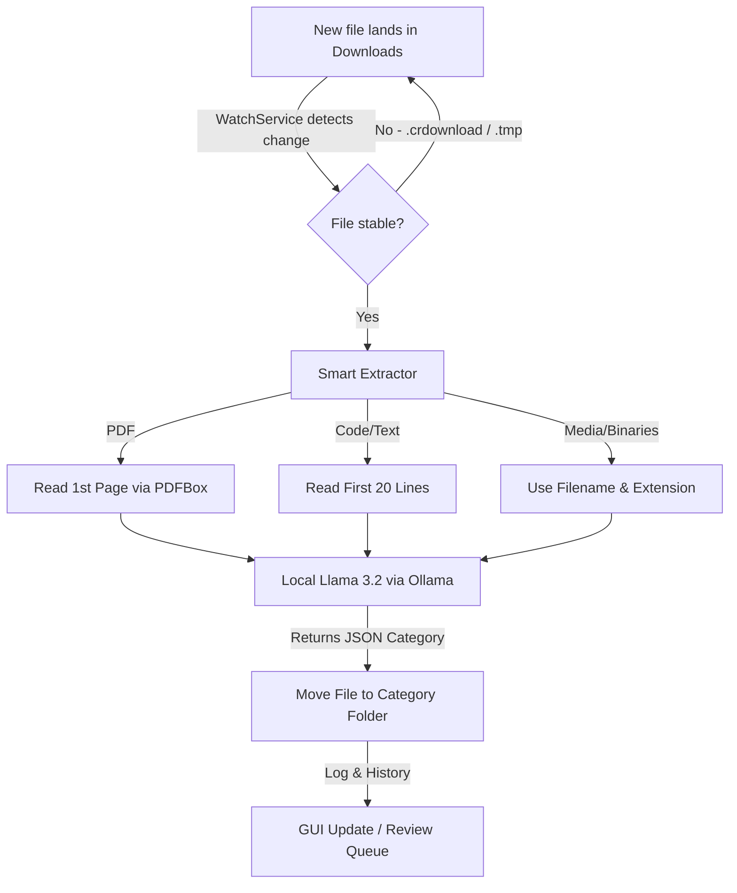

# 🗂️ Universal File Sorter

> **An AI-powered, 100% offline desktop application that tames your cluttered Downloads folder with zero cloud dependency and zero user intervention.**

[](https://hacktoberfest.com)
[](https://openjdk.org/)
[](https://ollama.com/)
[](LICENSE)

---

## 🏆 Hacktoberfest 2026 Entry
Proudly built as an entry for the **Hacktoberfest 2026 Week 4 "Slow and Steady" Challenge**—focusing on resilient, thoughtful local automation that respects user privacy and system resources over brute-force cloud APIs.

---

## ✨ Core Features

- **🔒 100% Offline & Private:** Powered entirely by a local instance of Ollama. Your personal documents, tax forms, invoices, and private code never leave your machine. Zero cloud APIs, zero telemetry, zero subscription fees.
- **⚡ Hardware-Friendly:** Optimized to run smoothly on mid-range GPUs (developed and tested on a 6GB VRAM GTX 1660) using the ultra-efficient **Llama 3.2 (3B)** model.
- **🧠 Smart Context Extraction (The "Slow & Steady" Approach):** Instead of choking models with giant files, it intelligently samples only what's needed:
  - **PDFs:** Extracts text from the first page using Apache PDFBox.
  - **Source Code & Text:** Reads the first 20 lines.
  - **Binaries & Media (`.zip`, `.exe`, `.png`, etc.):** Skips heavy reading and analyzes filename & extension alone.
- **🛡️ Robust Background Watcher:** Utilizes Java's `WatchService` on a background thread. It safely ignores partial/active downloads (like `.crdownload` or `.tmp`) to prevent file locks and corruption.
- **🖥️ Clean Java Swing GUI:** A sleek desktop interface featuring live status logs, review queues, undo history, and an easy Start/Stop monitor toggle.

---

## 🛠️ Tech Stack

| Component | Technology / Library | Description |
| :--- | :--- | :--- |
| **Language** | Java 17+ | Modern, robust OOP language |
| **Build System** | Apache Maven | Dependency management and compilation |
| **GUI Framework** | Java Swing | Native desktop user interface |
| **Local AI Engine** | Ollama (`llama3.2`) | Local REST API server running at `http://localhost:11434` |
| **PDF Extraction** | Apache PDFBox (2.0.30) | Fast, reliable PDF text parsing |
| **JSON Parsing** | Gson (2.10.1) | Clean serialization and deserialization of structured AI responses |

---

## ⚙️ How It Works



1. **Monitor** — A background worker observes your Downloads directory using Java's `WatchService`.
2. **Filter & Stabilize** — Ignores incomplete downloads (`.crdownload`, `.part`, `.tmp`) to ensure files are fully written before touching them.
3. **Extract** — Pulls a lightweight context preview based on file type.
4. **Classify** — Sends the snippet to your local Llama 3.2 instance with a strict prompt forcing a standardized JSON category response.
5. **Organize** — Instantly routes the file into its designated subfolder (e.g., `Academics`, `Finance`, `Code`, `Media`).

---

## 📋 Prerequisites

Before running the application, ensure you have installed:

1. **Java Development Kit (JDK) 17 or higher**  
   Verify installation: `java -version`
2. **Apache Maven**  
   Verify installation: `mvn -version`
3. **Ollama** (for local AI inference)  
   - Download and install from [ollama.com](https://ollama.com/)
   - Pull the required Llama 3.2 model:
     ```bash
     ollama pull llama3.2
     ```
   - Ensure the Ollama server is running locally:
     ```bash
     ollama serve
     ```

---

## 🚀 Getting Started

### 1. Clone the Repository
```bash
git clone https://github.com/navadiadharmik05-hub/universal-sorter.git
cd universal-sorter
```

### 2. Build the Project
```bash
mvn clean compile
```

### 3. Run the Application
```bash
mvn exec:java -Dexec.mainClass="org.example.Main"
```

Once launched, use the GUI to point to your Downloads folder, hit **Start**, and watch your files organize themselves automatically!

---

## 🤝 Contributing

Contributions, bug reports, and feature requests are welcome! Feel free to open an issue or submit a pull request for Hacktoberfest.

1. Fork the project
2. Create your feature branch (`git checkout -b feature/amazing-feature`)
3. Commit your changes (`git commit -m 'Add some amazing feature'`)
4. Push to the branch (`git origin push feature/amazing-feature`)
5. Open a Pull Request

---

## 📄 License

Distributed under the MIT License. See [LICENSE](LICENSE) for more information.

---

<p align="center">
  Crafted with ☕ and local AI by <a href="https://github.com/navadiadharmik05-hub">@navadiadharmik05-hub</a>
</p>
🤖 Generated with [Claude Code](https://claude.com/claude-code)
Co-Authored-By: Claude Code <noreply@anthropic.com>
